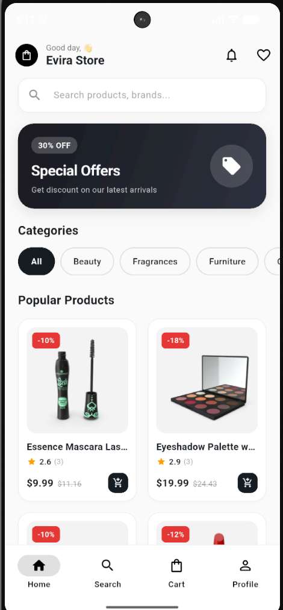
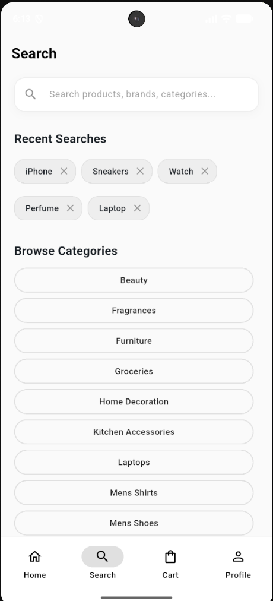
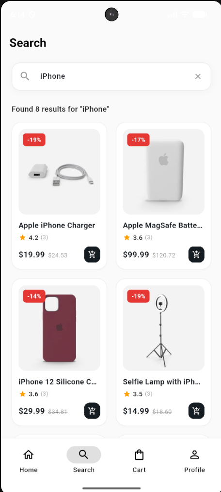
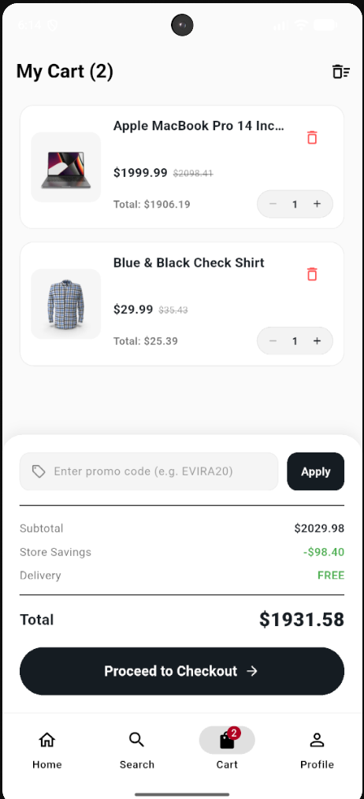
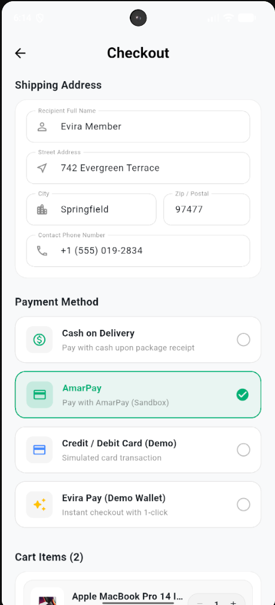
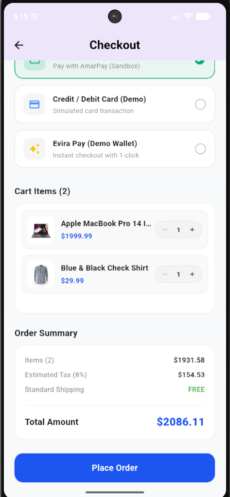
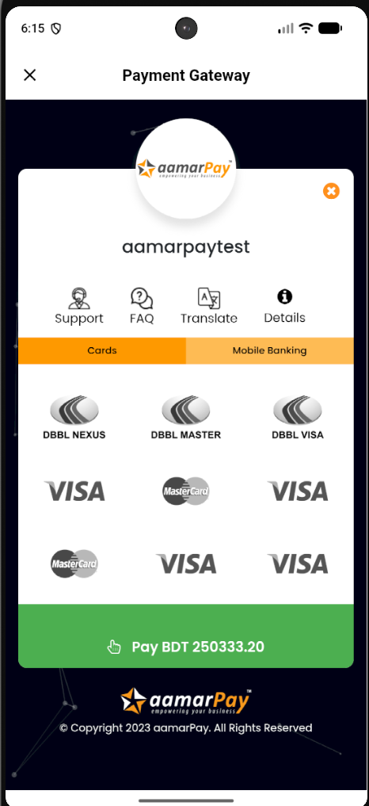

# 🛍️ Evira E-Commerce Mobile App

[](https://flutter.dev)
[](https://dart.dev)
[](#architecture--state-management)
[](file:///d:/Flutter_project/e_commerce_app_v1/test)
[](#-aamarpay-payment-gateway-integration)

A production-grade, high-performance Flutter e-commerce mobile application featuring the **Evira Design System**, live product inventory backed by [DummyJSON](https://dummyjson.com), offline-first cart persistence, order tracking, and fully integrated **aamarPay** payment gateway with in-app auto-redirection.

---

## 📱 App Screenshots

| 🏠 Home Screen | 🔍 Search & Categories | ⚡ Live Search |
| :---: | :---: | :---: |
|  |  |  |

| 🛒 Cart & Promo Codes | 💳 Checkout & Methods | 📋 Order Summary | 🔐 aamarPay In-App Gateway |
| :---: | :---: | :---: | :---: |
|  |  |  |  |

---

## ✨ Key Features

### 🎨 Evira Design System & UI
- **Modern Minimalist Aesthetic**: Figma-inspired typography, pill badges, fluid elevation, and consistent padding.
- **Dark & Light Mode**: Native theme switching with adaptive color schemes across all screens.
- **Responsive Navigation**: Persistent bottom navigation shell for instant switching between Home, Search, Cart, and Profile.

### 📦 Live Product Catalog & Search
- **Live Inventory**: Dynamic product list and category chips powered by the DummyJSON API.
- **Instant Search with Debounce**: 400ms keystroke debounce preventing network congestion while typing.
- **Search History**: Persistent recent searches with single-tap replay and deletion.
- **Product Detail**: Multi-angle image carousel, star rating badges, stock counters, and expandable specifications.

### 🛒 Offline-First Cart & Checkout
- **Local & Cloud Sync**: Hybrid offline cart with `SharedPreferences` caching and remote API synchronization.
- **Promo Code Engine**: Real-time discount validation (e.g. `EVIRA20` for 20% off).
- **Dynamic Delivery Calculation**: Automated free shipping threshold for orders over $50.00.
- **Swipe-to-Dismiss**: Smooth animated item deletion with instant undo options.

### 💳 aamarPay Payment Gateway Integration
- **In-App Payment Flow**: Seamless embedded gateway checkout without kicking users out to external browser tabs.
- **Currency Conversion**: Automatic USD to BDT conversion at checkout using live conversion factors (`1 USD ≈ 120 BDT`).
- **Auto-Redirect & Verification**: Instant transaction verification and automatic return to Order Confirmation.
- **Multiple Gateways Supported**: aamarPay (bKash, Nagad, Rocket, Cards), Cash on Delivery, Credit/Debit Card, and Evira Wallet.

### 📦 Order Management & User Profile
- **Ongoing & Completed Orders**: Segmented order tabs with progress stepper indicators (Placed ➔ Processing ➔ Shipped ➔ Delivered).
- **Order Details Modal**: Full itemized receipts with payment method and shipping address summaries.
- **User Authentication**: DummyJSON user login, session management, and guest mode.

---

## ⚡ Performance Optimizations

| Technique | Implementation Details |
| :--- | :--- |
| **Hardware-Bounded Image Decoding** | All network images specify `memCacheWidth` and `memCacheHeight` matching physical device pixels, cutting bitmap RAM allocation by ~85%. |
| **Disk Cache Bounds** | `maxWidthDiskCache: 1200` ensures huge camera images do not bloat device storage. |
| **HTTP Keep-Alive** | Reusable `http.Client` instances avoid repeated TLS handshake overhead. |
| **Virtual Rendering** | `SliverGrid` and `ListView.separated` guarantee smooth 60/120 FPS scrolling on mobile and web. |
| **Fast Static Analysis** | Cleaned legacy exports, reducing `flutter analyze` time from ~70s down to **3.1s**. |

---

## 🏗️ Project Architecture

```
lib/
├── core/
│   ├── models/            # ProductModel, CartModel, OrderModel
│   ├── network/           # DummyJsonService, API clients
│   ├── theme/             # AppTheme, ThemeProvider, AppColors
│   └── widgets/           # CustomNetworkImage, PriceTag, RatingBadge
├── features/
│   ├── home/              # HomeScreen, PromoBannerCard
│   ├── products/          # SearchScreen, ProductDetailScreen, ProductCard
│   ├── cart/              # CartScreen, CartItemTile, CartOrderSummary
│   ├── order/             # CheckoutPage, OrdersPage, AmarpayPaymentPage
│   │   ├── data/          # AmarpayService, PaymentConstants
│   │   └── providers/     # OrderProvider
│   └── profile/           # ProfilePage, SignInPage, AuthProvider
└── main.dart              # MultiProvider setup & application entry point
```

---

## 🚀 Getting Started

### Prerequisites
- [Flutter SDK](https://flutter.dev/docs/get-started/install) (`v3.47.4` or later)
- Android Studio / VS Code with Flutter extension
- Android Emulator or physical device

### Installation & Setup

1. **Clone the repository:**
   ```bash
   git clone https://github.com/munyimJR/e-commerce-app-evira-layout.git
   cd e-commerce-app-evira-layout
   ```

2. **Install dependencies:**
   ```bash
   flutter pub get
   ```

3. **Run the test suite:**
   ```bash
   flutter test
   ```
   *(All 60 unit and widget tests will execute and pass)*

4. **Launch on your Android Emulator:**
   ```bash
   # Start the emulator
   flutter emulators --launch Pixel_6a

   # Run the app
   flutter run -d android
   ```

5. **Launch on Web:**
   ```bash
   flutter run -d chrome
   ```

---

## 🧪 Testing

The project includes 60 automated unit, state provider, and widget tests:

```bash
flutter test
```
```
00:04 +60: All tests passed!
```
- **`test/repository/`**: Offline caching & remote synchronization tests.
- **`test/services/`**: aamarPay payment payload construction & timeout tests.
- **`test/state/`**: `CartProvider`, `AuthProvider`, `OrderProvider`, and `SearchProvider` test suites.
- **`test/widgets/`**: Navigation smoke tests, `CheckoutPage`, `AmarpayPaymentPage`, and `ProfilePage` tests.

---

## 📄 License
This project is open-source and available under the [MIT License](LICENSE).
